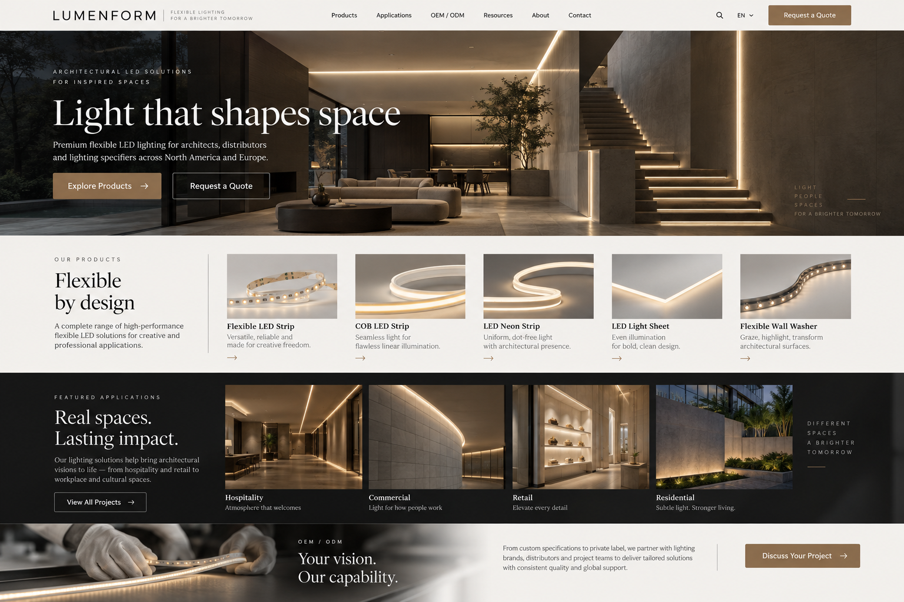
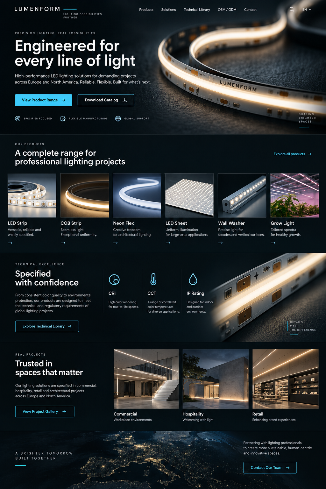
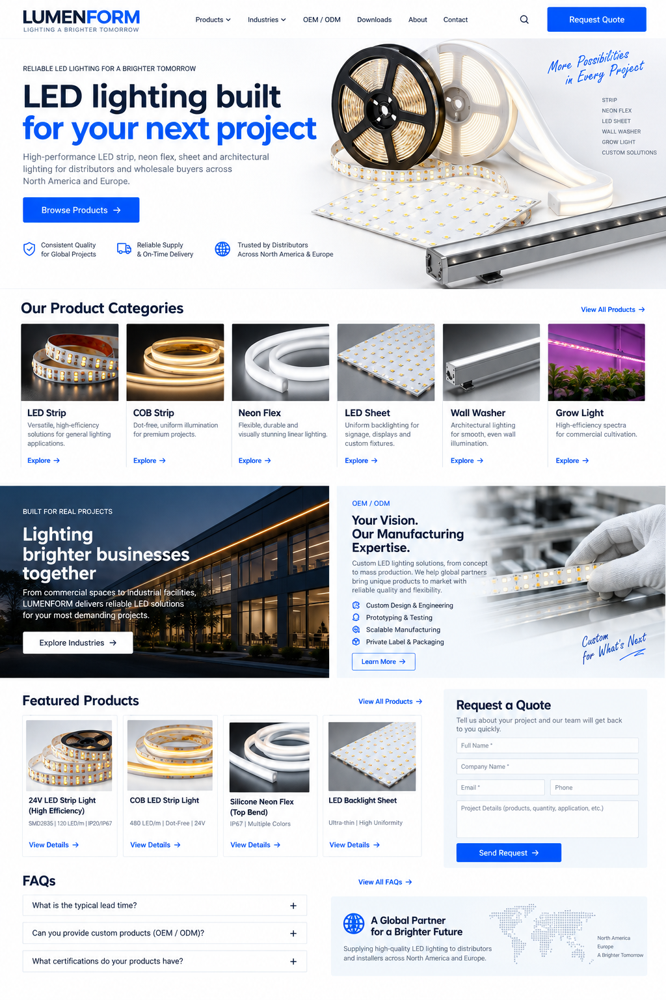

# LED lighting WordPress website concepts

Three English homepage concepts for a B2B LED lighting manufacturer selling to European and North American buyers. These are visual references, not installable WordPress themes. The brand name **LUMENFORM** is a placeholder.

The product scope follows [VH Smart Lighting](https://www.vhlighting.com/): LED strip, COB LED strip, LED neon strip, LED sheet, flexible wall washer, and grow light, with OEM/ODM enquiries.

## Option A — Architectural / premium

- **Audience:** architects, lighting designers, premium distributors.
- **Visual language:** warm stone, charcoal, bronze, editorial serif typography and architectural project photography.
- **Homepage flow:** hero → five key product families → project applications → OEM/ODM enquiry.
- **Best for:** a brand whose strongest sales asset is installed projects and design quality.

## Option B — Technical / specification-led

- **Audience:** lighting specifiers, contractors, system integrators and project buyers.
- **Visual language:** near-black surfaces, cyan accents, close-up product photography and compact technical modules.
- **Homepage flow:** hero → six product families → technical library → projects → contact.
- **Best for:** a catalog with reliable photometric files, drawings, installation guides and downloadable data sheets.

## Option C — Catalog / enquiry-led

- **Audience:** distributors, wholesalers and sourcing teams.
- **Visual language:** white background, graphite text, blue conversion actions and organized product photography.
- **Homepage flow:** hero → six categories → applications and OEM/ODM → featured products → quote form → FAQs.
- **Best for:** many SKUs and a priority on efficient quotation requests.

## WordPress page map

1. **Home:** chosen concept, product category entry points and a clear Request a Quote action.
2. **Products:** filters by family, voltage, CCT, CRI, IP rating and application where the data is available.
3. **Product detail:** product images, verified specifications, variant choices, installation information, datasheet download and enquiry form.
4. **Applications / Projects:** real installation cases with location, challenge, selected products and result.
5. **OEM / ODM:** customization options, workflow, order process and enquiry form.
6. **Resources:** verified datasheets, installation guides, certifications and FAQs.
7. **About / Contact:** company facts, factory evidence, address and enquiry channels.

## Content checks before publishing

Replace all generated imagery, placeholder branding and sample copy with approved assets. Verify every technical value, certification, warranty, production claim and regional availability. Collect complete English product specifications and real project photos before building product-detail pages.

## Interactive concepts D–F

Open [interactive/index.html](./interactive/index.html) to switch between three additional concepts. For a local HTTP preview, run `node serve.js` from the `interactive` directory and open `http://127.0.0.1:8876/`.

| Option | Direction | Working interaction | Best fit |
| --- | --- | --- | --- |
| D | 3D product studio + B2B lead generation | The banner reveals a brighter lighting-state image around the mouse; drag to rotate the LED reel; switch hospitality, retail and exterior application scenes; choose a product family and prefill the quote form | Premium brand and project enquiries |
| E | Spatial lighting story | Switch warm/neutral/dynamic scene color; drag comparison sliders; scroll reveal | Architects and project-driven sales |
| F | Technical specification builder | Select family, temperature, environment and application; receive a suggested product family | Distributors and specification-led buyers |

The interactive demos are frontend concepts, not installable WordPress themes. Their visuals use AI-generated product and architectural imagery. The specification builder is a UI example; it does not validate electrical suitability, certifications or product availability. The next production step would be replacing the sample model, copy and logic with approved product data and building the selected direction as WordPress templates.

The D banner uses two matched images: `hero-d.png` for the base state and `hero-d-lit.png` for the intensified warm-light state. The brighter image was generated by editing the base composition to increase only LED output and nearby stone reflections. A soft radial mask follows the pointer to reveal it; touch screens and reduced-motion settings use the stable base image.

D now flows from the interactive product banner to a full-width application scene, six product families, a project-buyer journey and a structured Request a Quote form. Product-family enquiry links preselect the relevant family. The form is a local preview and does not send or store messages; connect it to the WordPress enquiry workflow before publishing.

## GitHub Pages preview

The GitHub Actions workflow in `.github/workflows/pages.yml` publishes the `interactive` directory to GitHub Pages. The default URL opens option D; the switcher also exposes options E and F. This is a public design preview, and the enquiry form still does not send or store messages.
